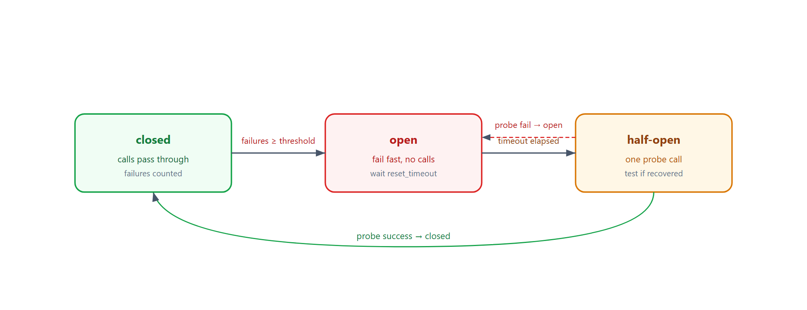
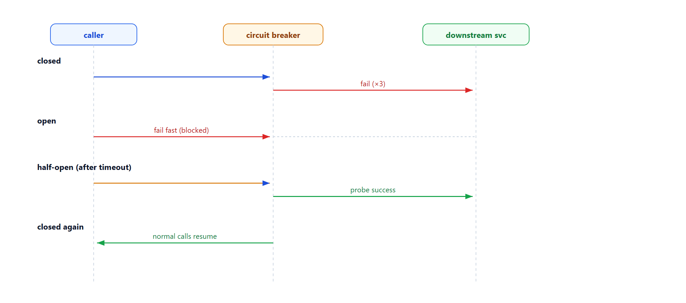

# Learn Circuit Breaker — Fail Fast, Recover Gracefully

> **Learning / study repo. Self-contained demo, NOT production code.**
> When a downstream keeps failing, stop calling it, fail fast, and after a cooldown
> probe whether it has recovered. This prevents cascading failure and self-heals.

## The idea

```
            failure threshold reached
 closed ───────────────────────────► open
   ▲                                  │
   │                                  │ reset_timeout elapsed
   │                                  ▼
   └──── success on probe ──────── half-open
```

- **closed** — normal calls pass through; failures counted.
- **open** — calls fail immediately (no waiting on a dead downstream).
- **half-open** — after a cooldown, let one probe through; success → closed, failure → open again.



## Why this matters

- **No cascading failure** — a slow/dead downstream doesn't tie up your threads and crash your service.
- **Fast failure** — callers get rejected immediately instead of timing out.
- **Self-healing** — once the downstream recovers, the probe flips the circuit back closed.

## Run

```bash
python run_all.py
```

Pure Python standard library.

## Demo cases

1. **Closed** — calls pass through normally.
2. **Opens** — 3 failures trips the breaker; further calls fail fast with `CIRCUIT OPEN`.
3. **Half-open success** — after the cooldown, the probe succeeds and the circuit closes again.
4. **Half-open failure** — probe fails, circuit goes back to open.

## Flow



## Sibling repos

- `learn_actor_model` — crash isolation per actor.
- `learn_raft_consensus` — consensus over replicated nodes.
- `learn_distributed_txn` — cross-service consistency.
